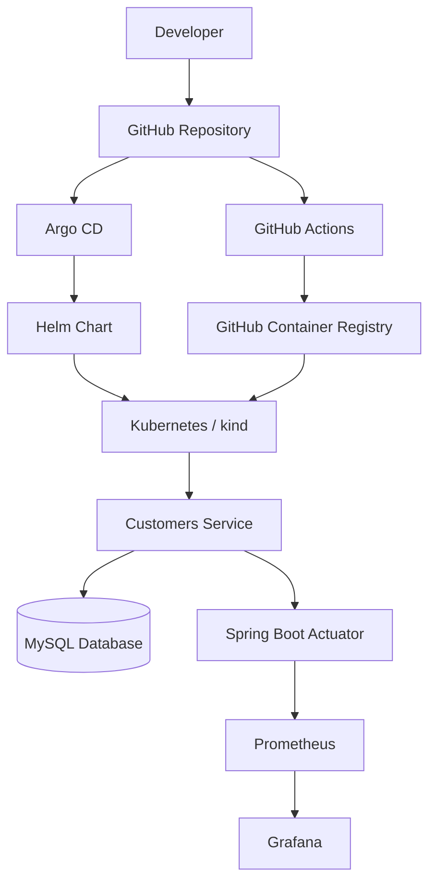
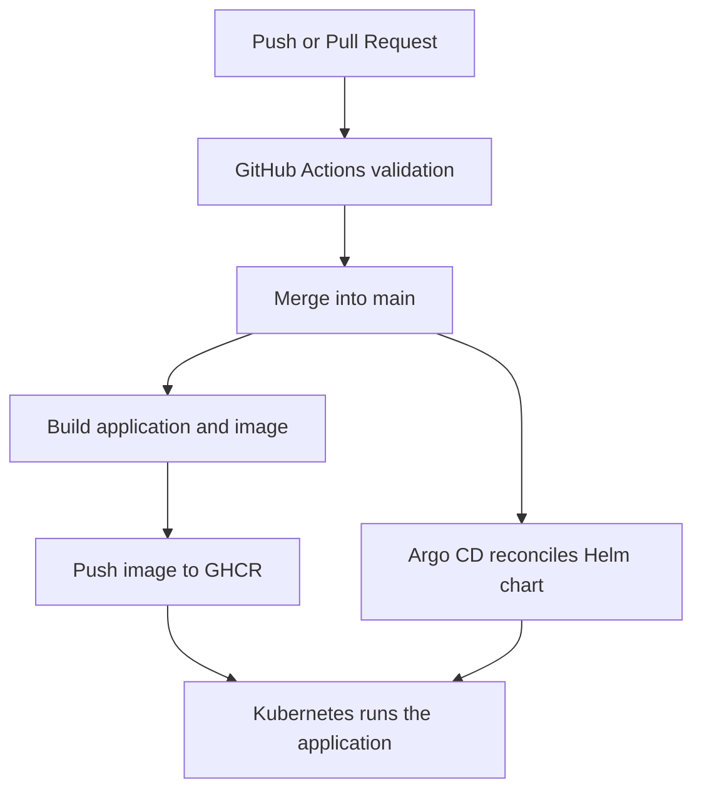

# DevOps Lab 01 — Customers Service

A hands-on DevOps learning project inspired by a mentor's GitHub repository. This project explores the complete workflow of building an application, packaging it into a container, deploying it to Kubernetes, managing deployments through GitOps, and monitoring application performance.

The primary goal is to understand how the components work together and how to troubleshoot them, rather than simply reproducing commands.

> **Project status:** Local learning environment. The application, Kubernetes deployment, GitOps workflow, and basic monitoring have been developed. AWS Terraform configuration is for practice and has not been applied to AWS.

---

## Table of Contents

1. [Project Objectives](#1-project-objectives)
2. [Architecture](#2-architecture)
3. [Technology Stack](#3-technology-stack)
4. [Repository Structure](#4-repository-structure)
5. [Infrastructure Overview](#5-infrastructure-overview)
6. [Application and Database](#6-application-and-database)
7. [Containerization](#7-containerization)
8. [Kubernetes with Kind](#8-kubernetes-with-kind)
9. [Helm](#9-helm)
10. [CI/CD with GitHub Actions](#10-cicd-with-github-actions)
11. [GitOps with Argo CD](#11-gitops-with-argo-cd)
12. [Monitoring with Prometheus and Grafana](#12-monitoring-with-prometheus-and-grafana)
13. [Terraform and AWS](#13-terraform-and-aws)
14. [Git Branching Workflow](#14-git-branching-workflow)
15. [Troubleshooting](#15-troubleshooting)
16. [Learning Outcomes](#16-learning-outcomes)
17. [Known Limitations and Future Improvements](#17-known-limitations-and-future-improvements)

---

## 1. Project Objectives

This project was created to practise an end-to-end DevOps workflow based on a mentor-inspired reference project.

The main objectives are:

- Build and package a Spring Boot application.
- Connect the application to a MySQL database.
- Containerize the application using Docker.
- Deploy the application to a local Kubernetes cluster.
- Manage Kubernetes resources with Helm.
- Automate application builds using GitHub Actions.
- Publish container images to GitHub Container Registry (GHCR).
- Reconcile Kubernetes resources using Argo CD.
- Expose application metrics with Micrometer.
- Collect and visualize metrics using Prometheus and Grafana.
- Learn infrastructure-as-code concepts using Terraform.

The project is intended as a learning environment and portfolio project. It is not yet a production-ready platform.

## 2. Architecture

### 2.1 High-level architecture



### 2.2 Application request flow

1. A client sends an HTTP request to `customers-service`.
2. The Spring Boot application processes the request.
3. The application reads from or writes to MySQL.
4. The application returns an HTTP response.
5. Micrometer exposes application metrics through `/actuator/prometheus`.
6. Prometheus scrapes the metrics endpoint.
7. Grafana queries Prometheus and visualizes the collected data.

### 2.3 Delivery flow

1. A developer creates a feature branch.
2. The changes are committed and pushed to GitHub.
3. A pull request is opened against `main`.
4. GitHub Actions runs the configured CI workflow.
5. After merging, the workflow builds and publishes the container image when its configured conditions are met.
6. Argo CD observes the desired configuration in Git.
7. Argo CD reconciles Kubernetes resources using the Helm chart.
8. Kubernetes runs the application using the configured image.

**Important distinction:** GitHub Actions builds and publishes the image, while Argo CD manages Kubernetes resources. Publishing a new image under the same `latest` tag does not automatically trigger a Kubernetes rollout.

## 3. Technology Stack

| Technology | Purpose |
|---|---|
| Java 21 | Application runtime and development |
| Spring Boot | REST API framework |
| Maven Wrapper | Build and package the Java application |
| MySQL | Relational database |
| Docker | Container image creation |
| Kubernetes | Container orchestration |
| Kind | Local Kubernetes cluster |
| Helm | Kubernetes configuration templating |
| GitHub Actions | CI/CD automation |
| GHCR | Container image registry |
| Argo CD | GitOps continuous delivery |
| Micrometer | Application metrics instrumentation |
| Prometheus | Metrics collection and querying |
| Grafana | Metrics visualization |
| Terraform | Infrastructure as code |
| AWS | Proposed cloud infrastructure target |

Check the repository configuration files for the exact versions currently in use.

## 4. Repository Structure

The following represents the main project areas. Confirm the current file structure with `find` because individual filenames may change as the project evolves.

```text
devops-lab-01/
├── .github/
│   └── workflows/
│       └── ci.yaml
├── services/
│   └── customers-service/
│       ├── pom.xml
│       ├── mvnw
│       └── src/
│           └── main/
│               └── resources/
│                   └── application.properties
├── k8s/
│   └── argocd/
│       └── customers-service-app.yaml
├── helm/
│   └── customers-service/
│       ├── Chart.yaml
│       ├── values.yaml
│       └── templates/
├── monitoring/
│   ├── kube-prometheus-stack-values.yaml
│   ├── customers-service-servicemonitor.yaml
│   └── customers-service-alerts.yaml
├── terraform/
│   └── aws/
│       ├── environments/
│       │   └── dev/
│       └── modules/
│           ├── network/
│           ├── ecr/
│           ├── eks/
│           └── rds/
└── docs/
    └── aws-architecture.md
```

The monitoring alert file is included in the structure only if it has been created and committed. Likewise, the Dockerfile and Compose file locations should be checked against the actual repository.

## 5. Infrastructure Overview

### 5.1 Local environment

The project runs on a Fedora workstation with Docker and Kind.

The local environment contains:

- A Kind Kubernetes cluster named `kind-devops-lab-01`.
- The Spring Boot application and MySQL database in the `default` namespace.
- Argo CD in the `argocd` namespace.
- Prometheus and Grafana in the `monitoring` namespace.

Verify the current cluster and resources:

```bash
kind get clusters
kubectl config current-context
kubectl get nodes
kubectl get pods -A
kubectl get services -A
```

### 5.2 Kubernetes namespaces

| Namespace | Purpose |
|---|---|
| `default` | Application and database resources |
| `argocd` | Argo CD components |
| `monitoring` | Prometheus, Grafana, and monitoring components |

### 5.3 Cloud infrastructure

The Terraform configuration describes a potential AWS environment in the Singapore region (`ap-southeast-1`).

The proposed components include a VPC, public and private subnets, ECR, an EKS control plane, and RDS MySQL.

These resources have **not** been created in AWS. The configuration is for learning and static validation only.

## 6. Application and Database

The application is a Spring Boot REST service named `customers-service`.

Its primary responsibility is to expose customer-related API endpoints and interact with a MySQL database.

### Database configuration

The Kubernetes environment uses:

| Setting | Value |
|---|---|
| Database engine | MySQL |
| Database name | `petclinic` |
| Service hostname | `mysql` |
| Port | `3306` |

Actual credentials and connection settings must be taken from the project's configuration. Never put real passwords or tokens in this README.

### Build the application

From the repository root:

```bash
./services/customers-service/mvnw \
  -f services/customers-service/pom.xml \
  --batch-mode clean package \
  -Dmaven.test.skip=true
```

This reproduces the packaging command used during the learning process. The option `-Dmaven.test.skip=true` skips test compilation and execution, so a successful build does not establish that the tests pass.

Once tests are implemented, prefer:

```bash
./services/customers-service/mvnw \
  -f services/customers-service/pom.xml \
  --batch-mode clean verify
```

### Test application health

When the service is accessible locally:

```bash
curl -i http://localhost:8080/actuator/health
```

Use the actual host port configured by your environment. In the Kubernetes monitoring exercise, the application is forwarded to local port `8083`.

## 7. Containerization

Docker packages the application and its runtime dependencies into a container image.

The local learning image used during development was:

```text
customers-service:1.1
```

The image published to GHCR is:

```text
ghcr.io/bluezapus/customers-service
```

Find the Dockerfile and confirm its build context before building:

```bash
find . -maxdepth 4 -type f \
  \( -iname 'Dockerfile*' -o -iname '*.dockerfile' \)
```

For example, if the Dockerfile is located at `services/customers-service/Dockerfile` and expects that directory as its context:

```bash
docker build \
  -t customers-service:1.1 \
  -f services/customers-service/Dockerfile \
  services/customers-service
```

Adjust the command if the repository uses a different Dockerfile location or build context.

Inspect available images:

```bash
docker images | grep customers-service
```

### Why the image must be rebuilt

Updating Java source code does not change an image that has already been built. A new image must be built and published before Kubernetes can run the updated application.

For reproducible releases, immutable image tags based on the Git commit SHA are preferable to relying exclusively on `latest`.

## 8. Kubernetes with Kind

Kind creates a local Kubernetes cluster using Docker containers as cluster nodes.

Check the existing cluster:

```bash
kind get clusters
kubectl config get-contexts
kubectl get nodes
```

The existing cluster name is `kind-devops-lab-01`. Its context is normally `kind-kind-devops-lab-01`.

If creating a new cluster for the first time:

```bash
kind create cluster --name devops-lab-01
kubectl cluster-info --context kind-devops-lab-01
```

Use the exact context name reported by `kubectl config get-contexts`.

### Load a local image

Kind nodes do not automatically share every image in the host's Docker image store. To test a locally built image:

```bash
kind load docker-image customers-service:1.1 \
  --name devops-lab-01
```

The Kubernetes Deployment must use the corresponding local image and a suitable image pull policy for this workflow. The GHCR-based GitOps workflow is separate.

### Inspect resources

```bash
kubectl get deployments -n default
kubectl get pods -n default
kubectl get services -n default
kubectl describe deployment customers-service-gitops -n default
```

Kubernetes concepts practised in this project include Deployments, Pods, Services, labels, selectors, container ports, image pull policies, and rolling restarts.

## 9. Helm

Helm packages Kubernetes resource templates and configuration values into a chart.

The application chart is located at:

```text
helm/customers-service/
```

Its values configure the image repository, image tag, pull policy, and service/container ports.

The GitOps release name used in this lab is:

```text
customers-service-gitops
```

### Validate the chart

```bash
helm lint helm/customers-service
helm template customers-service-gitops helm/customers-service
```

The first command checks chart structure. The second renders the templates locally without deploying them.

### Inspect the release

```bash
helm list -A
helm get values customers-service-gitops -n default
helm get manifest customers-service-gitops -n default
```

In the Argo CD environment, the chart is managed through GitOps. Make lasting configuration changes in Git instead of relying on manual changes to live Kubernetes resources.

## 10. CI/CD with GitHub Actions

The CI workflow is located at:

```text
.github/workflows/ci.yaml
```

The workflow builds the application and handles image publishing according to its configured event triggers.

### General workflow



This is a conceptual flow; the exact sequence depends on the conditions in the workflow file. Inspect `.github/workflows/ci.yaml` for the actual triggers and job dependencies.

### GHCR image

The registry image is:

```text
ghcr.io/bluezapus/customers-service:latest
```

The workflow uses GitHub Actions' `GITHUB_TOKEN` for registry authentication. Do not commit registry passwords or personal access tokens.

### Verify a workflow run

1. Open the repository on GitHub.
2. Navigate to **Actions**.
3. Open the latest workflow run.
4. Check that the build and image-publishing steps completed successfully.
5. Confirm that the expected image tag was published.

A successful feature-branch build does not necessarily publish a new image. Image publishing depends on the configured trigger conditions.

### Image update considerations

The Helm chart currently uses the `latest` tag. Updating the registry tag does not, by itself, modify the Kubernetes Deployment's Pod template.

After confirming that the image was successfully published, the local learning environment can trigger a rollout:

```bash
kubectl rollout restart deployment/customers-service-gitops \
  -n default

kubectl rollout status deployment/customers-service-gitops \
  -n default --timeout=180s
```

This is a manual refresh step, not a fully automated image-update mechanism. A more robust implementation would publish immutable tags and update Helm values to the exact version being deployed.

## 11. GitOps with Argo CD

Argo CD continuously compares the desired Kubernetes configuration in Git with the live state of the cluster.

The Application manifest is:

```text
k8s/argocd/customers-service-app.yaml
```

Its configuration points to:

| Setting | Value |
|---|---|
| Repository | `https://github.com/bluezapus/devops-lab-01.git` |
| Target revision | `main` |
| Chart path | `helm/customers-service` |
| Release name | `customers-service-gitops` |
| Automatic synchronization | Enabled in the current configuration |

### Inspect Argo CD

```bash
kubectl get pods -n argocd
kubectl get applications -n argocd
kubectl describe application customers-service-gitops -n argocd
```

The Application's sync and health status help diagnose whether Git and the cluster agree.

### Access the UI

Run:

```bash
kubectl port-forward svc/argocd-server 8080:443 -n argocd
```

Open:

```text
https://localhost:8080
```

Use the credentials configured for the existing Argo CD installation. Do not store administrative passwords in this repository.

### Important GitOps principle

Git is the source of truth for the desired application configuration. If the live resource is changed manually, Argo CD may overwrite the change during reconciliation.

For durable changes:

1. Edit the Helm chart or configuration in Git.
2. Validate the changes.
3. Commit and push the feature branch.
4. Open a pull request.
5. Merge after review and CI validation.
6. Confirm Argo CD synchronizes the new configuration.

## 12. Monitoring with Prometheus and Grafana

The monitoring stack uses the `kube-prometheus-stack` Helm chart.

The local values file is:

```text
monitoring/kube-prometheus-stack-values.yaml
```

Prometheus collects metrics, while Grafana visualizes them.

The current lab configuration uses short Prometheus retention, disables Alertmanager, and does not persist Grafana data. Consequently, this setup is intended for local experimentation rather than durable monitoring.

### 12.1 Micrometer and Spring Boot Actuator

The service includes the Micrometer Prometheus registry dependency in:

```text
services/customers-service/pom.xml
```

The Actuator endpoint exposure configuration is in:

```text
services/customers-service/src/main/resources/application.properties
```

The relevant property is:

```properties
management.endpoints.web.exposure.include=health,info,prometheus
```

The application exposes:

| Endpoint | Purpose |
|---|---|
| `/actuator/health` | Health status |
| `/actuator/info` | Application information, if configured |
| `/actuator/prometheus` | Prometheus-compatible metrics |

### 12.2 ServiceMonitor

The ServiceMonitor manifest is:

```text
monitoring/customers-service-servicemonitor.yaml
```

It configures Prometheus Operator discovery for the application Service and scrapes `/actuator/prometheus` through the named `http` port.

Inspect and apply it:

```bash
kubectl get service customers-service-gitops \
  -n default --show-labels

kubectl get servicemonitor -n default

kubectl apply -f monitoring/customers-service-servicemonitor.yaml
```

The ServiceMonitor selector must match the labels on the Service, and Prometheus must select the ServiceMonitor's labels and namespace. A successful `kubectl apply` alone does not prove that Prometheus is scraping the application.

### 12.3 Test application metrics

Forward the application Service:

```bash
kubectl port-forward svc/customers-service-gitops \
  8083:8080 -n default
```

Keep that terminal open. In another terminal:

```bash
curl -i http://localhost:8083/actuator/health
curl -fsS http://localhost:8083/actuator
curl -fsS http://localhost:8083/actuator/prometheus | head -n 20
```

The Actuator index should include a Prometheus link, and the metrics endpoint should return metric data rather than HTTP 404.

If the endpoint returns 404, inspect the dependency, application properties, container image, and running Pod logs. Correct source code does not guarantee that the running container contains the latest build.

### 12.4 Open Prometheus

Forward the Prometheus Service:

```bash
kubectl port-forward svc/monitoring-kube-prometheus-prometheus \
  9090:9090 -n monitoring
```

Open these pages:

- Targets: `http://localhost:9090/targets`
- Query interface: `http://localhost:9090/graph`
- Alerts: `http://localhost:9090/alerts`

Check that the application target is `UP`.

Starter PromQL queries:

**Target availability**

```promql
up
```

**HTTP request count**

```promql
http_server_requests_seconds_count
```

**Request rate**

```promql
sum(rate(http_server_requests_seconds_count[5m]))
```

**JVM heap memory**

```promql
jvm_memory_used_bytes{area="heap"}
```

The exact metric names and labels depend on the application and scrape configuration. Start with `up` and inspect available labels before adding restrictive filters.

### 12.5 Open Grafana

Forward the Grafana Service:

```bash
kubectl port-forward svc/monitoring-grafana \
  3000:80 -n monitoring
```

Open:

```text
http://localhost:3000
```

The usual initial username is `admin`. Retrieve the password from the installed Secret:

```bash
kubectl get secret monitoring-grafana \
  -n monitoring \
  -o jsonpath='{.data.admin-password}' | base64 -d

echo
```

Prometheus should be available as a data source through the `kube-prometheus-stack` configuration.

Suggested dashboard panels:

| Panel | Example PromQL |
|---|---|
| Request rate | `sum(rate(http_server_requests_seconds_count[5m]))` |
| JVM heap usage | `jvm_memory_used_bytes{area="heap"}` |
| JVM process CPU | `process_cpu_usage` |
| Scrape status | `up` |

Dashboards created manually in Grafana are not necessarily stored in Git. Export dashboard JSON if you want reproducible, version-controlled dashboards.

### 12.6 Alerting

Alert rules are an optional follow-up to the basic monitoring setup.

A PrometheusRule resource can evaluate conditions such as:

- The application target is down.
- The expected target is missing.
- The application is returning HTTP 5xx responses.

Do not consider alerting complete until the PrometheusRule is present in the cluster and its rules appear on the Prometheus Alerts page.

Alert evaluation and notification delivery are different things. The current configuration disables Alertmanager, so email or chat notifications require additional configuration.

## 13. Terraform and AWS

The Terraform project is under:

```text
terraform/aws/
```

The intended region is:

```text
ap-southeast-1
```

### 13.1 Modules

| Module | Intended responsibility |
|---|---|
| `network` | VPC and public/private subnets |
| `ecr` | Container image repository |
| `eks` | EKS control plane and IAM role |
| `rds` | Private MySQL RDS database configuration |
| `environments/dev` | Composes the infrastructure modules |

The architecture documentation is:

```text
docs/aws-architecture.md
```

Read the Terraform source and architecture document for the current implementation details.

### 13.2 Validate without deploying

From the development environment directory:

```bash
cd terraform/aws/environments/dev

terraform fmt -recursive
terraform init
terraform validate
```

`terraform init` downloads provider dependencies and creates the local `.terraform/` directory.

Commit `.terraform.lock.hcl` where appropriate, but do not commit `.terraform/`, state files, credentials, or secret values.

A `terraform plan` that queries AWS may fail if valid AWS credentials are unavailable. That does not mean the local Terraform files cannot be formatted or statically validated.

**Do not run `terraform apply` unless you deliberately configure an AWS account, review the potential cost and security implications, and intend to create real resources.**

### 13.3 Known AWS limitations

The current configuration is a learning exercise, not a production-ready AWS environment.

Areas that require additional design include:

- EKS worker capacity: the current EKS module describes the control plane but does not yet provision a managed node group or other worker capacity.
- Network egress for private subnets.
- Security-group connectivity between the application and RDS.
- Secrets management and IAM permissions.
- RDS deletion protection and final-snapshot behaviour.
- Resource sizing, access control, and cost management.

No AWS resources have been created as part of this exercise.

## 14. Git Branching Workflow

The project uses feature branches and pull requests rather than committing changes directly to `main`.

### Start a feature branch

```bash
cd ~/devops-lab-01

git switch main
git pull --ff-only origin main
git switch -c feature/short-description
```

### Validate changes

```bash
git status --short
git diff --check
git diff
```

Run the relevant build, chart, or configuration validation commands before committing.

### Commit and push

```bash
git add <files>
git commit -m "Describe the change"
git push -u origin feature/short-description
```

Then open a pull request to `main`, review the CI result, and merge after the expected checks pass.

After merging, verify that GitHub Actions completed successfully and that Argo CD reconciled the desired state.

## 15. Troubleshooting

### 15.1 Prometheus endpoint returns HTTP 404

Verify the source configuration:

```bash
grep -n "micrometer-registry-prometheus" \
  services/customers-service/pom.xml

grep -n "management.endpoints.web.exposure.include" \
  services/customers-service/src/main/resources/application.properties
```

Inspect the running application:

```bash
kubectl logs deployment/customers-service-gitops \
  -n default --tail=100

kubectl get deployment customers-service-gitops \
  -n default \
  -o jsonpath='{.spec.template.spec.containers[*].image}{"\n"}'
```

Confirm that the latest image was built and published, then roll out the updated image.

### 15.2 Prometheus cannot discover the service

```bash
kubectl get servicemonitor -n default -o yaml

kubectl get service customers-service-gitops \
  -n default --show-labels

kubectl get prometheus -n monitoring -o yaml
```

Check:

- The ServiceMonitor selector matches the Service labels.
- The endpoint port name matches the Service port name.
- The scrape path is `/actuator/prometheus`.
- Prometheus selects the ServiceMonitor's labels and namespace.

### 15.3 Application Pod cannot connect to MySQL

```bash
kubectl get pods -n default

kubectl get service mysql -n default

kubectl get endpoints mysql -n default

kubectl logs deployment/customers-service-gitops \
  -n default --tail=100
```

Check the database hostname, port, credentials, MySQL readiness, and Kubernetes events. Avoid exposing database credentials in terminal screenshots or public logs.

### 15.4 Argo CD reports OutOfSync

```bash
kubectl get applications -n argocd

kubectl describe application customers-service-gitops \
  -n argocd
```

Inspect the Application's source revision, chart path, sync status, and Helm values. Make durable changes in Git rather than repeatedly modifying live resources.

### 15.5 Terraform reports missing AWS credentials

This is expected when attempting AWS operations without valid credentials.

Continue with local formatting and validation. Do not commit credentials or apply infrastructure simply to make the error disappear.

## 16. Learning Outcomes

By reproducing this project, the intended learning outcomes are:

### Docker and containers

- Understand how source code becomes a container image.
- Understand image tags and why source changes require rebuilding.
- Understand the difference between a local image and a registry image.

### CI/CD

- Understand GitHub Actions triggers and job execution.
- Trace build failures through workflow logs.
- Understand how images are authenticated, tagged, and published to GHCR.

### Kubernetes

- Understand Deployments, Pods, Services, labels, and selectors.
- Inspect rollout status and application logs.
- Troubleshoot image-pull and database connectivity issues.

### Helm

- Understand values files and templates.
- Render manifests before deployment.
- Track configuration changes through Git.

### Argo CD

- Understand Git as the source of truth.
- Inspect synchronization and application health.
- Explain why manual cluster changes can be overwritten by reconciliation.

### Observability

- Understand the role of Micrometer and Actuator.
- Verify a Prometheus scrape target.
- Write basic PromQL queries.
- Use Grafana to visualize application metrics.
- Distinguish alert-rule evaluation from notification delivery.

### Terraform

- Understand modules, variables, outputs, and environment composition.
- Format and validate infrastructure configuration.
- Recognize the difference between valid Terraform code and infrastructure that has actually been deployed.

## 17. Known Limitations and Future Improvements

The primary learning goal is to reproduce the application delivery workflow and add basic monitoring. The following are possible improvements rather than prerequisites for completing the reproduction exercise.

- [ ] Implement and run meaningful unit tests instead of skipping them in CI.
- [ ] Use immutable image tags based on Git commit SHAs.
- [ ] Automate the update of Helm values to reference a specific image version.
- [ ] Export Grafana dashboards to JSON and version-control them.
- [ ] Verify Prometheus alert rules and configure Alertmanager if notifications are required.
- [ ] Add appropriate resource requests, limits, health probes, and container security settings.
- [ ] Improve secret handling and application configuration.
- [ ] Complete the AWS design only when a suitable cloud environment and budget are available.
- [ ] Record verified commands, outputs, and troubleshooting lessons as the lab evolves.

---

## Final Notes

This project is a learning environment for understanding the path from a code change to a running, monitored application.

The most important outcome is not the number of tools installed. It is the ability to explain how each component works, why it is needed, how it connects to the other components, and how to troubleshoot it when something fails.

Use this README as a reference, but always treat the actual repository configuration and verified runtime behaviour as the source of truth.
